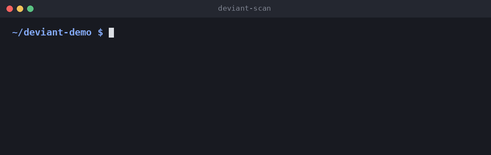

<p align="center">
  <picture>
    <source media="(prefers-color-scheme: dark)" srcset="docs/assets/logo-dark.svg">
    
  </picture>
</p>

<p align="center">
  <b>Find the one thing in your code that breaks the pattern.</b>
</p>

<p align="center">
  Deviant learns your project's own conventions, flags the exceptions,<br>
  and shows the git history you need to judge them.
</p>

<p align="center">
  <a href="https://pypi.org/project/deviant-scan/"></a>
  <a href="https://github.com/ImalkaPerera/deviant/actions/workflows/ci.yml"></a>
  
  <a href="LICENSE"></a>
  
</p>

<p align="center">
  <a href="https://imalkaperera.github.io/deviant/">Website</a> ·
  <a href="#quick-start">Quick start</a> ·
  <a href="#how-it-works">How it works</a> ·
  <a href="#what-it-checks">What it checks</a> ·
  <a href="#results">Results</a> ·
  <a href="#contribute">Contribute</a>
</p>

---

Picture a project with 48 API routes. 47 of them check who is calling. The 48th doesn't, and it
exports every user's data. Nobody noticed.

Every codebase runs on unwritten rules: every route checks auth, every CI job has a timeout,
every action is pinned to a commit. Nobody writes them down, so nobody checks them. Code review
catches what the reviewer remembers. AI coding agents write code that looks right and passes
tests, but can quietly forget the check every other route has.

Deviant counts what your code already does, picks out the rare item that breaks the pattern, and
shows the git history behind it. You write no rules.

<p align="center">
  
</p>

`n=48 s=47 v=1` means 48 similar routes, 47 that check auth and 1 that doesn't. The one that
doesn't was added in a commit called *add csv export*, by someone who wrote none of the 47 that
do. Try it on the same project: `python docs/demo/make_demo_project.py ~/deviant-demo`.

> **With Deviant, Claude found 82% of planted bugs instead of 70%, for a third less.**
> [How we measured it](#results)

## Highlights

- **Finds the odd one out.** It learns your project's own conventions by counting: no rules to
  write, no AI, no API key, and the same answer every time.
- **Evidence, not guesses.** With `--with-git`, each finding comes with git history: who changed
  it, when, why, and how many of the protected items that person wrote.
- **A verdict with proof, inside Claude Code.** The plugin labels each finding as a bug,
  intentional or unsure, and cites the line, test or commit that shows it. It treats the scanned
  code as data, so a comment telling it to skip a check is reported, not obeyed.
- **Safe to run on code you don't trust.** It reads and parses files and never runs them. Git
  evidence uses read-only commands. Use the latest release; see [SECURITY.md](SECURITY.md).
- **Ready for CI.** `--json` for tools and `--fail-on-findings` to fail a job. See
  [using it in CI](docs/using-in-ci.md).

## Quick start

You need Python 3.10 or newer and git.

```bash
pip install deviant-scan
deviant-scan path/to/your/project --with-git
```

To run it once without installing anything: `uvx deviant-scan path/to/your/project --with-git`.

To have Claude judge each exception and review the code around it, install the plugin in Claude
Code and run it on a project:

```text
/plugin install deviant --marketplace ImalkaPerera/deviant
/deviant:deviant path/to/project
```

See [using Deviant in Claude Code](docs/claude-code-skill.md). The plugin runs the Python on your
path, so run `pip install PyYAML` first if you want it to check GitHub Actions workflows.

## How it works

1. **Group.** A check lists similar things: every FastAPI route, every CI job.
2. **Count.** Plain math finds the pattern ("47 of 48 do this") and the rare exceptions. There
   is no AI in this step.
3. **Show the evidence.** Each exception comes with its git history.
4. **Judge** (Claude Code skill). Claude reads each exception with its evidence and labels it a
   bug, intentional or unsure, with proof.
5. **Review** (Claude Code skill). Claude then reads the route and workflow files and compares
   every handler and job with its siblings, for the bugs no count can see: an inverted
   condition, a swallowed failure, a check one handler skips.

The scan only reports a pattern when the evidence is strong, so a small project may show nothing
from it alone. That is why the skill also reviews the code. The details are in
[how it works](docs/how-it-works.md) and [limits](docs/limits.md).

## What it checks

| Check | Compares | Finds |
|---|---|---|
| **FastAPI routes** | each route with the others in its folder | a route missing the auth or rate limit its neighbours have (a missing response model shows with `--include-style`) |
| **GitHub Actions** | every workflow and composite action | an action not pinned to a commit, a job with no timeout or concurrency setting, a workflow with no permissions block, a shell step that ignores its own failure (shown with `--inventory`) |

Auth set on a router or a parent app counts, so routes protected from above are not reported.
See [detectors](docs/detectors.md).

## How is this different?

| | Linters and Semgrep | Asking an AI to review the code | **Deviant** |
|---|---|---|---|
| Needs rules written first | Yes, or uses rules someone else wrote | No | **No**, it learns from your code |
| Notices "47 do this, one doesn't" | Only if a rule describes it | Often, but it varies from run to run | **Yes**, it counts, once a group has enough items |
| Same answer every run | Yes | Not guaranteed | **Yes** (the scan) |
| Cost per scan | Free | Tokens | **Free and local** (the scan) |
| Why it flagged something | A rule message | An explanation in prose | **Numbers and git history** |

Deviant does not replace your linter or your reviewers. It finds what only counting can see, and
with the skill it gives an AI reviewer a method instead of a blank page.

## Results

We publish what Deviant got wrong, not only what it got right. Every number below links to its
page in [`bench/results`](bench/results/), with its limits.

**The skill against Claude alone, on bugs planted in repos it had never seen**
([details](bench/results/fresh-set-2-benchmark.md))

| | Claude alone | Claude with Deviant |
|---|---|---|
| Bugs found (84 bugs, 3 runs each) | 70% | **82%** |
| Workflow steps that ignore their failure | 54% | **83%** |
| Route conditions turned the wrong way round | 94% | 93% |
| Removed job timeouts (8 bugs, one repo) | **38%** | 25% |
| Cost for 60 runs | $8.82 | **$5.70** |

- The repos were chosen by a rule written down first, and the skill was frozen before they were
  scanned. The 95% interval for the gain is +1.4 to +23.6 points, so it is real but its size is
  uncertain.
- **Not measured yet:** how many of each side's reports are false alarms. This shows the skill
  finds more, not that it is more often right.
- The earlier skill, which only judged the scan's leads, lost on the first sealed set (35%
  against 55%). Reading the code itself is what turned that around.

**The scan alone, with no AI,** pointed at 25 of 35 real bugs taken from public fix commits
([details](bench/results/real-bugs.md)). It has been run on 547 real projects, with every
candidate read by hand and every false alarm written down
([tested on real projects](docs/tested-on-real-projects.md)).

## Roadmap

Done: the scan with git evidence, FastAPI and GitHub Actions checks, the Claude Code skill, a
sealed benchmark, a PyPI release and a CI mode. Next:

- [ ] False alarms labeled by hand, to show whether the skill is also more often right
- [ ] More checks: Dockerfiles, Flask, Express, Spring, Kubernetes, Terraform
- [ ] SARIF output for GitHub code scanning, and a ready-made GitHub Action
- [ ] Saved rules, and a hook that warns an AI agent the moment it breaks one

## Contribute

Deviant is early, and early contributors shape what it becomes. **A check is one Python file**
that collects facts. Deviant does all the counting, so if you know a framework well enough to say
"every X should have a Y", you can add it.

| Start here | Effort |
|---|---|
| A Dockerfile check: non-root `USER`, pinned base image. The [contributor guide](CONTRIBUTING.md) has it written out | Easy |
| Flask, Express or Spring route checks, in the same way the FastAPI check works | Medium |
| SARIF output, so findings show in GitHub code scanning | Medium |
| Run it on your project and tell us what it found or missed | Five minutes |

- **Add a check.** Copy the [short template](skills/deviant/scripts/deviant_scan/detectors/_template.py).
  The [contributor guide](CONTRIBUTING.md) has a complete example and [more ideas](CONTRIBUTING.md#where-to-help).
- **Report a false alarm.** If Deviant flags something that is fine,
  [open an issue](https://github.com/ImalkaPerera/deviant/issues/new/choose). These reports improve
  it fastest.

No API key is needed to run any test. If Deviant is useful to you, a star helps other people
find it.

## Learn more

[Website](https://imalkaperera.github.io/deviant/) · [How it works](docs/how-it-works.md) ·
[Claude Code skill](docs/claude-code-skill.md) ·
[Reading the output](docs/reading-the-output.md) ·
[Detectors](docs/detectors.md) · [Configuration](docs/configuration.md) ·
[Using it in CI](docs/using-in-ci.md) ·
[Limits](docs/limits.md) · [Benchmarks](bench/results/) ·
[Tested on real projects](docs/tested-on-real-projects.md) · [Security](SECURITY.md)

The idea comes from Engler et al., [*Bugs as Deviant Behavior*](https://www.cs.columbia.edu/~junfeng/09fa-e6998/papers/deviant.pdf)
(SOSP 2001), which showed that rare exceptions to a common pattern often point to real bugs.

Licensed under either of the [MIT license](LICENSE) or the [Apache License 2.0](LICENSE-APACHE), at your option.
