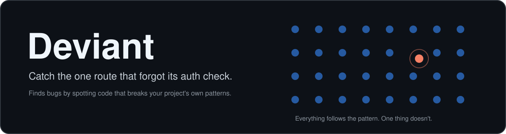
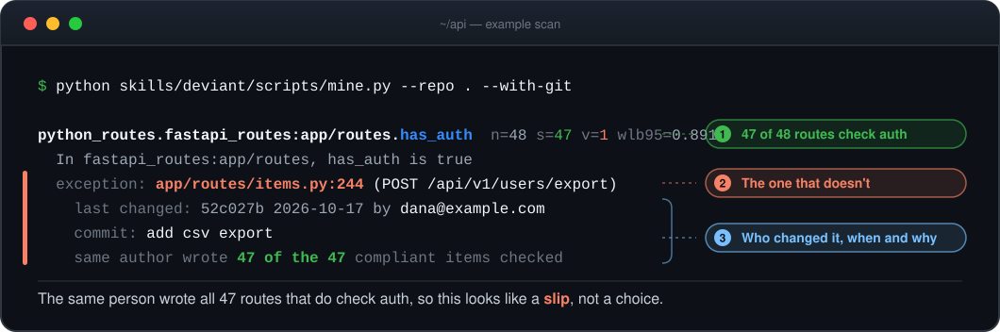
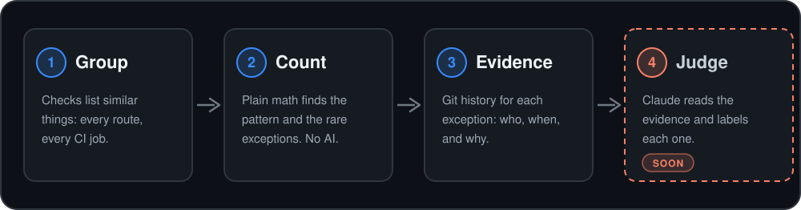

<p align="center">
  
</p>

<p align="center">
  <b>Deviant learns what your project normally does, then flags the one thing that doesn't.</b>
</p>

<p align="center">
  <a href="https://github.com/ImalkaPerera/deviant/actions/workflows/ci.yml"></a>
  
  <a href="LICENSE"></a>
  
  <a href="CONTRIBUTING.md"></a>
</p>

<p align="center">
  <a href="#quick-start">Quick start</a> ·
  <a href="#how-it-works">How it works</a> ·
  <a href="#what-it-checks">What it checks</a> ·
  <a href="docs/tested-on-real-projects.md">Tested on real projects</a> ·
  <a href="#contribute">Contribute</a>
</p>

---

**47 of your 48 API routes check who is calling. The 48th doesn't, and it exports every user's data.
Nobody noticed.**

Deviant finds that route. It counts what your code already does, picks out the rare item that
breaks the pattern, and shows you the git history behind it. You write no rules.

<p align="center">
  
</p>

## Highlights

- 🎯 **Finds the odd one out.** It learns your project's own conventions by counting, so there
  are no rules to write.
- 🧮 **Same code, same answer.** Finding the exceptions needs no AI, no API key, no network
  and no token bill.
- 🔎 **Evidence, not guesses.** Each finding comes with the git history: who changed it, when,
  why, and how many of the protected items that person wrote.
- 🛡️ **Built to be safe on code you don't trust.** It reads and parses files and never runs them.
- 🧩 **A check is one Python file.** Adding support for your framework means writing one file.
- 🧪 **Tested on real projects**, with the false alarms we found [written down](docs/tested-on-real-projects.md).

## Quick start

Deviant is early, so install from source. You need Python 3.10 or newer and git.

```bash
git clone https://github.com/ImalkaPerera/deviant.git
cd deviant
pip install -e ".[yaml]"

python skills/deviant/scripts/mine.py --repo /path/to/your/project --with-git
```

Add `--json` for machine-readable output. A PyPI release (`uvx deviant-scan .`) is planned.

## How it works

<p align="center">
  
</p>

A pattern is only reported when the evidence is strong: a group of at least 20 similar items,
with one to three exceptions. Small projects will often show nothing, on purpose. The math is
in [how it works](docs/how-it-works.md), and the trade-offs are in [limits](docs/limits.md).

## What it checks

| Check | Compares | Finds |
|---|---|---|
| **FastAPI routes** | each route with the others in its folder | a route missing the auth, rate limit or response model its neighbours have |
| **GitHub Actions** | every workflow and composite action | an action not pinned to a commit, a job with no timeout, a workflow with no permissions block |

FastAPI auth is followed through routers, shared dependencies and `include_router`, so routes
that are protected from above are not reported. See [detectors](docs/detectors.md).

## How is this different?

| | Linters and Semgrep | Asking an AI to review the code | **Deviant** |
|---|---|---|---|
| Needs rules written first | Yes, or uses rules someone else wrote | No | **No**, it learns from your code |
| Notices "47 do this, one doesn't" | Only if a rule describes it | Can miss it when it only shows up across hundreds of files | **Yes**, it counts |
| Same answer every run | Yes | Not guaranteed | **Yes** |
| Cost per scan | Free | Tokens | **Free**, and local |
| Why it flagged something | A rule message | An explanation in prose | **Numbers and git history** |

Deviant does not replace your linter or your reviewers. It finds the thing only counting can see.

## Roadmap

- [x] Count patterns and report the rare exceptions
- [x] FastAPI and GitHub Actions checks, with git evidence
- [ ] A Claude Code skill that judges each finding: bug, intentional or unsure
- [ ] Saved rules, and a hook that warns an AI agent the moment it breaks one
- [ ] More checks: Dockerfiles, Flask, Express, Spring, Kubernetes, Terraform
- [ ] A published benchmark against asking Claude alone
- [ ] A PyPI release

## Contribute

Deviant is early, and early contributors shape what it becomes. **A check is one Python file.**
If you know a framework well enough to say "every X should have a Y", you can add it.

| 🧩 Add a check | 🐞 Report a false alarm | 🧪 Try it on your project |
|---|---|---|
| Copy the [short template](skills/deviant/scripts/detectors/_template.py). The [guide](CONTRIBUTING.md) has a complete example and [starter ideas](CONTRIBUTING.md#where-to-help). | Deviant flagged something that is fine? These reports improve it fastest. [Open one](https://github.com/ImalkaPerera/deviant/issues/new/choose). | Run it, and tell us what it found or missed. Add it to [tested on real projects](docs/tested-on-real-projects.md). |

No API key is needed to run any test.

## Learn more

[How it works](docs/how-it-works.md) · [Reading the output](docs/reading-the-output.md) ·
[Detectors](docs/detectors.md) · [Configuration](docs/configuration.md) ·
[Limits](docs/limits.md) · [Security](SECURITY.md)

The idea comes from Engler et al., [*Bugs as Deviant Behavior*](https://www.cs.columbia.edu/~junfeng/09fa-e6998/papers/deviant.pdf)
(SOSP 2001), which showed that rare exceptions to a common pattern often point to real bugs.
Related work: [Laravel `infer-conventions`](https://laravel.com/blog/extracting-ai-rules-from-an-existing-codebase),
[codebase-dna-guardian](https://github.com/mturac/codebase-dna-guardian),
[Trail of Bits `semgrep-rule-creator`](https://lobehub.com/skills/trailofbits-skills-semgrep-rule-creator).

<p align="center">
  <sub>If Deviant would have caught a bug for you, a ⭐ helps others find it. · <a href="LICENSE">MIT license</a></sub>
</p>
