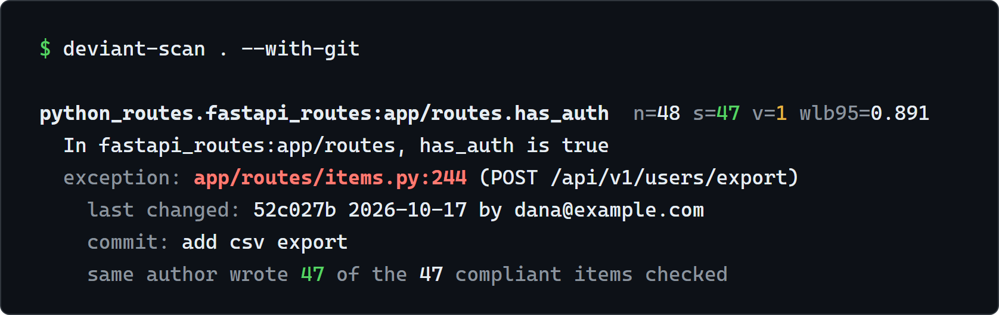

<p align="center">
  <picture>
    <source media="(prefers-color-scheme: dark)" srcset="docs/assets/logo-dark.svg">
    
  </picture>
</p>

<p align="center">
  <b>Find the one thing in your code that breaks the pattern.</b>
</p>

<p align="center">
  Deviant learns your project's own conventions, flags the exceptions,<br>
  and shows the git history you need to judge them.
</p>

<p align="center">
  <a href="https://pypi.org/project/deviant-scan/"></a>
  <a href="https://github.com/ImalkaPerera/deviant/actions/workflows/ci.yml"></a>
  
  <a href="LICENSE"></a>
  
</p>

<p align="center">
  <a href="#quick-start">Quick start</a> ·
  <a href="#how-it-works">How it works</a> ·
  <a href="#what-it-checks">What it checks</a> ·
  <a href="docs/tested-on-real-projects.md">Tested on real projects</a> ·
  <a href="#contribute">Contribute</a>
</p>

---

47 of your 48 API routes check who is calling. The 48th doesn't, and it exports every user's
data. Nobody noticed.

Every codebase runs on unwritten rules: every route checks auth, every CI job has a timeout,
every action is pinned to a commit. Nobody writes them down, so nobody checks them. Code review
catches what the reviewer remembers. AI coding agents write code that looks right and passes
tests, but can quietly forget the check every other route has.

Deviant counts what your code already does, picks out the rare item that breaks the pattern, and
shows the git history behind it. You write no rules.

<p align="center">
  
</p>

Reading the output: `n=48 s=47 v=1` means 48 similar routes, 47 that check auth and 1 that doesn't.
The exception is at `app/routes/items.py:244`. The last two lines are the evidence: the same
person wrote all 47 routes that do check auth, so this looks like a slip, not a choice.

## Highlights

- **Finds the odd one out.** It learns your project's own conventions by counting, so there are
  no rules to write.
- **Deterministic.** The same code gives the same answer. Finding the exceptions needs no AI, no
  API key and no network.
- **Evidence, not guesses.** Each finding comes with git history: who changed it, when, why, and
  how many of the protected items that person wrote.
- **Safe to run on code you don't trust.** It reads and parses files and never runs them. Git
  evidence uses read-only commands.
- **Extensible.** A check is one Python file.
- **Tested on real projects,** with the false alarms we found [written down](docs/tested-on-real-projects.md).

## Quick start

You need Python 3.10 or newer and git.

```bash
pip install deviant-scan
deviant-scan path/to/your/project --with-git
```

To run it once without installing anything, use `uvx deviant-scan path/to/your/project --with-git`.

To have Claude judge each exception, install the plugin in Claude Code and run it on a project:

```text
/plugin install deviant --marketplace ImalkaPerera/deviant
/deviant:deviant path/to/project
```

It labels each exception as a bug, intentional or unsure, with proof. See
[using Deviant in Claude Code](docs/claude-code-skill.md).

Add `--json` for machine-readable output. Output is colored in a terminal and plain when piped
(`--color never` and the `NO_COLOR` variable turn it off). To work on Deviant itself, see the
[contributor guide](CONTRIBUTING.md).

## How it works

1. **Group.** A check lists similar things: every FastAPI route, every CI job.
2. **Count.** Plain math finds the pattern ("47 of 48 do this") and the rare exceptions. There
   is no AI in this step.
3. **Show the evidence.** Each exception comes with its git history.
4. **Judge.** The [Claude Code skill](docs/claude-code-skill.md) reads the evidence and labels
   each exception as a bug, intentional or unsure, with proof.

A pattern is only reported when the evidence is strong: a group of at least 20 similar items with
one to three exceptions. Small projects will often show nothing, on purpose. The math is in
[how it works](docs/how-it-works.md) and the trade-offs are in [limits](docs/limits.md).

## What it checks

| Check | Compares | Finds |
|---|---|---|
| **FastAPI routes** | each route with the others in its folder | a route missing the auth, rate limit or response model its neighbours have |
| **GitHub Actions** | every workflow and composite action | an action not pinned to a commit, a job with no timeout, a workflow with no permissions block |

FastAPI auth is followed through routers, shared dependencies and `include_router`, so routes
that are protected from above are not reported. See [detectors](docs/detectors.md).

## How is this different?

| | Linters and Semgrep | Asking an AI to review the code | **Deviant** |
|---|---|---|---|
| Needs rules written first | Yes, or uses rules someone else wrote | No | **No**, it learns from your code |
| Notices "47 do this, one doesn't" | Only if a rule describes it | Often, but it varies from run to run | **Yes**, it counts, once a group has enough items |
| Same answer every run | Yes | Not guaranteed | **Yes** |
| Cost per scan | Free | Tokens | **Free**, and local |
| Why it flagged something | A rule message | An explanation in prose | **Numbers and git history** |

Deviant does not replace your linter or your reviewers. It finds what only counting can see.

## Honest by design

We publish what Deviant got wrong, not only what it got right.

- **547 real projects scanned** (from 577 found on GitHub), and every candidate read by hand.
- **One candidate at the default settings.** It turned out to be intentional: the project's own
  test asserts that the route is public.
- **Eight problems found and fixed** while reading real results and reviewing the code, each with a
  regression test. The early version flagged all 23 routes of the FastAPI template as unprotected.
- **The Claude Code skill was run in real sessions** on a real bug, an intentional exception and
  a prompt-injection attempt, and handled all three. That is three scenarios, not a benchmark.
- **No confirmed bug in someone else's project yet,** and no accuracy number yet.
- **A first benchmark is published, and it is not flattering.** On bugs planted in ten real
  repos, Claude reading the code alone found 56%, and the scan alone found few. See
  [the results](bench/results/).

The full story is in [tested on real projects](docs/tested-on-real-projects.md).

## Roadmap

- [x] Count patterns and report the rare exceptions
- [x] FastAPI and GitHub Actions checks, with git evidence
- [x] A Claude Code skill that judges each finding: bug, intentional or unsure
- [ ] Saved rules, and a hook that warns an AI agent the moment it breaks one
- [ ] More checks: Dockerfiles, Flask, Express, Spring, Kubernetes, Terraform
- [ ] A benchmark that shows Deviant beating asking Claude alone (a first one is in `bench/results/`)
- [x] A PyPI release

## Contribute

Deviant is early, and early contributors shape what it becomes. A check is one Python file. If
you know a framework well enough to say "every X should have a Y", you can add it.

- **Add a check.** Copy the [short template](skills/deviant/scripts/deviant_scan/detectors/_template.py). The
  [contributor guide](CONTRIBUTING.md) has a complete example and [starter ideas](CONTRIBUTING.md#where-to-help).
- **Report a false alarm.** If Deviant flags something that is fine,
  [open an issue](https://github.com/ImalkaPerera/deviant/issues/new/choose). These reports improve
  it fastest.
- **Try it on your project** and tell us what it found or missed.

No API key is needed to run any test.

## Learn more

[How it works](docs/how-it-works.md) · [Claude Code skill](docs/claude-code-skill.md) ·
[Reading the output](docs/reading-the-output.md) ·
[Detectors](docs/detectors.md) · [Configuration](docs/configuration.md) ·
[Limits](docs/limits.md) · [Security](SECURITY.md)

The idea comes from Engler et al., [*Bugs as Deviant Behavior*](https://www.cs.columbia.edu/~junfeng/09fa-e6998/papers/deviant.pdf)
(SOSP 2001), which showed that rare exceptions to a common pattern often point to real bugs.
Related work: [Laravel `infer-conventions`](https://laravel.com/blog/extracting-ai-rules-from-an-existing-codebase),
[codebase-dna-guardian](https://github.com/mturac/codebase-dna-guardian),
[Trail of Bits `semgrep-rule-creator`](https://lobehub.com/skills/trailofbits-skills-semgrep-rule-creator).

Licensed under either of the [MIT license](LICENSE) or the [Apache License 2.0](LICENSE-APACHE), at your option.
